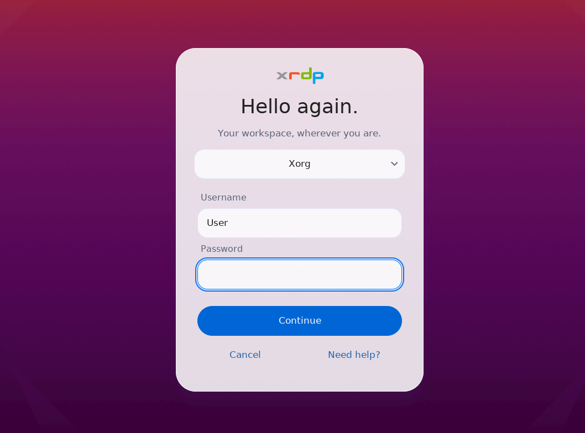

Automated bash script to compile and install the latest **xrdp** (`devel` branch) with the modern **LVGL (v9.3+)** pre-session login interface and **xorgxrdp** on **Ubuntu 24.04 LTS**.


This installer is **Desktop Environment (DE) agnostic**—it sets up the core X11/RDP stack and leaves the choice of desktop environment up to you.

## What This Script Does:

1. **Installs Core Dependencies:** Sets up minimal X11 utilities, build tools (`cmake`, `autotools`, `gcc`), and fonts (`fonts-quicksand` for rounded LVGL typography and `fonts-dejavu-core` for full Unicode/Cyrillic support).

2. **Compiles LVGL v9.3+:** Clones LVGL, configures required heap/UTF-8/FreeType macros, builds the shared library, and copies private headers needed by `xrdp`.

3. **Compiles `xrdp` (`devel`):** Builds `xrdp` with `--enable-lvgl`, `--with-imlib2` (for transparent PNG logos/backgrounds), and `--enable-pixman`.

4. **Compiles `xorgxrdp` (`devel`):** Builds the matching Xorg video/input driver with `--disable-glamor` to prevent Xorg crashes on virtual machines/VPS without dedicated GPUs.

5. **Configures Security & Permissions:**
   - Creates a dedicated unprivileged `xrdp` system user and `/run/xrdp` tmpfiles rule.
   - Generates TLS/RSA keys (`cert.pem`, `key.pem`, `rsakeys.ini`) with proper read permissions for the `xrdp` group.
   - Configures `/etc/X11/Xwrapper.config` to allow non-root users to start Xorg sessions.
   - Disables direct `root` RDP logins (`AllowRootLogin=false`) in `/etc/xrdp/sesman.ini`.
   - Enables the LVGL UI (`ls_ui=lvgl`) and sets `DejaVuSans.ttf` as the default fallback font in `/etc/xrdp/xrdp.ini`.

---

## 🚀 Prerequisites

Before connecting via RDP, make sure you have:
1. **A non-root user** with `sudo` privileges (root RDP login is disabled by default for security):
   ```bash
   sudo adduser your_username
   sudo usermod -aG sudo your_username
   ```
2. **A Desktop Environment installed** (e.g., XFCE4, GNOME, MATE, Cinnamon, or KDE Plasma).

---

## 📦 Installation

1. Download or clone this repository on your Ubuntu 24.04 server:
   ```bash
   git clone https://github.com/sanotes-ru/
   cd xrdp-modern-lvgl-installer
   ```

2. Make the script executable and run it as `root`:
   ```bash
   chmod +x install_xrdp_lvgl.sh
   sudo ./install_xrdp_lvgl.sh
   ```

3. If you have UFW firewall enabled, allow RDP traffic on port `3389`:
   ```bash
   sudo ufw allow 3389/tcp
   ```

---

## 🖥️ Desktop Environment Configuration (`/etc/xrdp/startwm.sh`)

By default, `xrdp` calls the built-in `wm_start` function at the bottom of `/etc/xrdp/startwm.sh`. Depending on your Desktop Environment, you may need to explicitly define the session startup command (using `exec` ensures clean single-click logout without restarting the session).

Open `/etc/xrdp/startwm.sh`:
```bash
sudo nano /etc/xrdp/startwm.sh
```

Scroll to the bottom, comment out `wm_start` (`# wm_start`), and add the block for your DE right before `exit 1`:

### 1. XFCE4/Xubuntu
*Install minimal XFCE4 if not installed: `sudo apt install -y --no-install-recommends xfce4 xfce4-terminal`*
```bash
# Optional: set your preferred locale
# export LANG=en_US.UTF-8

exec dbus-run-session -- startxfce4

# wm_start
exit 1
```

### 2. GNOME
*Install minimal GNOME if not installed: `sudo apt install -y --no-install-recommends ubuntu-desktop-minimal`*
```bash
export GNOME_SHELL_SESSION_MODE=ubuntu
export XDG_CURRENT_DESKTOP=ubuntu:GNOME
export XDG_CONFIG_DIRS=/etc/xdg/xdg-ubuntu:/etc/xdg

exec dbus-run-session -- gnome-session

# wm_start
exit 1
```

### 3. MATE Desktop
*Install MATE if not installed: `sudo apt install -y --no-install-recommends mate-desktop-environment-core`*
```bash
exec dbus-run-session -- mate-session

# wm_start
exit 1
```

### 4. Cinnamon
*Install Cinnamon if not installed: `sudo apt install -y --no-install-recommends cinnamon-core`*
```bash
exec dbus-run-session -- cinnamon-session

# wm_start
exit 1
```

### 5. KDE Plasma
*Install minimal KDE if not installed: `sudo apt install -y --no-install-recommends kde-plasma-desktop`*
```bash
export XDG_CURRENT_DESKTOP=KDE
exec dbus-run-session -- startplasma-x11

# wm_start
exit 1
```

*(Note: Alternatively, instead of editing `/etc/xrdp/startwm.sh` globally, individual users can place their startup command into `~/.xsession` inside their home directory and make it executable with `chmod +x ~/.xsession`).*

---

## 🎨 Customization & Reverting to Legacy UI

You can customize the LVGL login screen in `/etc/xrdp/xrdp.ini` under the `[Globals]` section:

- **Switch back to the classic Windows 95-style login UI:**
  ```ini
  ls_ui=legacy
  ```
- **Custom Logo (supports transparent PNG via Imlib2):**
  ```ini
  ls_logo_filename=/path/to/your/logo.png
  ```
- **Custom Background Image & Scaling Mode:**
  ```ini
  ls_background_image=/path/to/your/wallpaper.png
  ls_background_transform=none
  ; Background scaling modes:
  ; none   - display the image at its original resolution (centered/unscaled)
  ; scale  - stretch the image to fill the entire screen (ignoring aspect ratio)
  ; zoom   - scale the image proportionally to cover the screen (may crop edges) 
  ```

After making changes to `/etc/xrdp/xrdp.ini`, restart the service:
```bash
sudo systemctl restart xrdp
```
